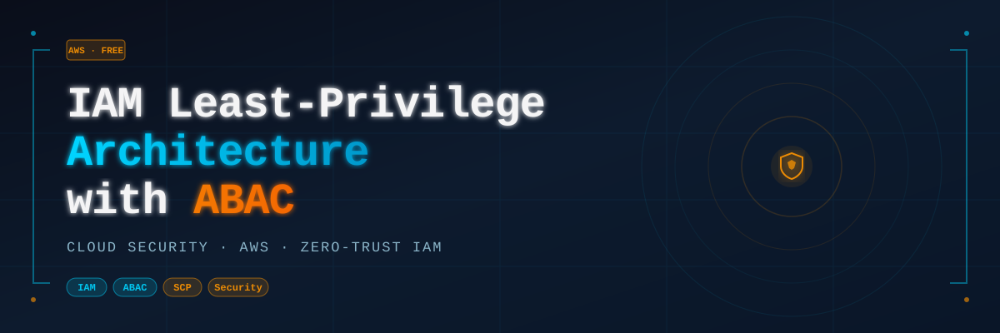

<div align="center">
  
</div>

<br/>

<div align="center">


</div>

---

## 📌 Overview

This project demonstrates a **production-grade, zero-trust IAM architecture** on AWS, built entirely on the Free Tier. It covers identity design, attribute-based access control, permission boundaries, organizational guardrails, and automated threat detection — the core skills tested in cloud security interviews.

> **Role:** Cloud Security Engineer (Junior)
> **Platform:** AWS Free Tier
> **Duration:** ~4–5 hours
> **Difficulty:** ⬛⬛⬛⬜⬜ Intermediate

---

## 🏗️ Architecture Diagram

```
┌─────────────────────────────────────────────────────────────────┐
│                     AWS Organizations                           │
│  ┌──────────────────────────────────────────────────────────┐  │
│  │  Management Account (Root)                               │  │
│  │  SCP: PreventSecurityToolsTampering                      │  │
│  │                                                          │  │
│  │  ┌──────────────────────────────────┐                   │  │
│  │  │  Dev-OU                          │                   │  │
│  │  │  ┌────────────────────────────┐  │                   │  │
│  │  │  │  IAM Users                 │  │                   │  │
│  │  │  │  alice-dev  → dev-team     │  │                   │  │
│  │  │  │  bob-ops    → ops-team     │  │                   │  │
│  │  │  │  carol-sec  → security-team│  │                   │  │
│  │  │  └────────────────────────────┘  │                   │  │
│  │  │  ┌────────────────────────────┐  │                   │  │
│  │  │  │  ABAC Tags                 │  │                   │  │
│  │  │  │  team | env | cost-center  │  │                   │  │
│  │  │  └────────────────────────────┘  │                   │  │
│  │  │  ┌────────────────────────────┐  │                   │  │
│  │  │  │  DevRoleWithBoundary        │  │                   │  │
│  │  │  │  Boundary: DeveloperPB     │  │                   │  │
│  │  │  └────────────────────────────┘  │                   │  │
│  │  └──────────────────────────────────┘                   │  │
│  │                                                          │  │
│  │  IAM Access Analyzer ──→ Findings ──→ Alert             │  │
│  └──────────────────────────────────────────────────────────┘  │
└─────────────────────────────────────────────────────────────────┘
```

---

## ✅ What Was Built — Phase by Phase

### Phase 1 — IAM Users, Groups & Scoped Policies
No wildcard (`*`) actions. Every permission is intentional and scoped.

| Group | Policy | Permissions |
|---|---|---|
| `dev-team` | `DevTeamPolicy` | S3 get/list/put on `dev-*` buckets only |
| `ops-team` | `OpsTeamPolicy` | EC2 start/stop/describe, CloudWatch read |
| `security-team` | `SecurityTeamPolicy` | IAM read + Access Analyzer view |

### Phase 2 — ABAC (Attribute-Based Access Control)
Dynamic, tag-driven authorization. Users can only act on resources whose `team` tag matches their own IAM `PrincipalTag`.

```json
"Condition": {
  "StringEquals": {
    "ec2:ResourceTag/team": "${aws:PrincipalTag/team}"
  }
}
```

Tags applied to IAM users:

| User | team | env | cost-center |
|---|---|---|---|
| alice-dev | dev | dev | cc-100 |
| bob-ops | ops | prod | — |
| carol-sec | security | — | — |

### Phase 3 — Permission Boundaries
A `DeveloperPermissionBoundary` policy caps the **maximum** permissions for the `DevRoleWithBoundary` role — even if someone attaches `AdministratorAccess` to it later, the boundary holds.

```
Effective Permissions = IAM Policy ∩ Permission Boundary
```

### Phase 4 — Service Control Policies (SCPs)
`PreventSecurityToolsTampering` SCP is attached to `Dev-OU` inside AWS Organizations. It hard-denies:
- Disabling or deleting CloudTrail
- Disabling GuardDuty detectors

These denies cannot be overridden by any IAM user or role — not even an account admin.

### Phase 5 — IAM Access Analyzer
Deployed an **External Access** analyzer (free tier) that scans all resources for unintended public or cross-account access. Triggered a live finding by creating a public S3 bucket policy — analyzer flagged it within minutes.

---

## 📸 Screenshots

| # | Step | Screenshot |
|---|---|---|
| 1 | Access Analyzer detected public S3 bucket | [View](screenshots/01_Access_Analyzer_Finding.png) |
| 2 | Attaching custom policy to security-team group | [View](screenshots/02_Attaching_Policies_to_Group.png) |
| 3 | Public bucket policy (test trigger for analyzer) | [View](screenshots/03_S3_Bucket_Policy_Public.png) |
| 4 | Admin IAM user created with AdministratorAccess | [View](screenshots/04_Admin_IAM_User_Created.png) |
| 5 | Access Analyzer created (External Access, free) | [View](screenshots/05_Access_Analyzer_Created.png) |
| 6 | All 3 custom policies created (Customer managed) | [View](screenshots/06_Custom_Policies_Created.png) |
| 7 | 3 IAM groups created (dev, ops, security) | [View](screenshots/07_IAM_Groups_Created.png) |
| 8 | 4 IAM users created and assigned to groups | [View](screenshots/08_IAM_Users_Assigned_to_Groups.png) |
| 9 | Dev-OU created inside AWS Organizations | [View](screenshots/09_Organizational_Unit_Dev-OU.png) |
| 10 | Scoped policy JSON in policy editor | [View](screenshots/10_Creating_Scoped_Policies.png) |
| 11 | DevRoleWithBoundary created with permission boundary | [View](screenshots/11_DevRole_Permission_Boundary.png) |
| 12 | Test S3 bucket created for analyzer trigger | [View](screenshots/12_S3_Test_Bucket.png) |
| 13 | SCP PreventSecurityToolsTampering deployed | [View](screenshots/13_SCP_PreventSecurityToolsTampering.png) |
| 14 | ABAC tags applied to alice-dev | [View](screenshots/14_ABAC_Tags_alice-dev.png) |

---

## 📁 Repository Structure

```
aws-iam-project/
├── README.md                          ← You are here
├── banner.svg                         ← Project banner
├── policies/
│   ├── DevTeamPolicy.json             ← Scoped S3 + EC2 Describe
│   ├── OpsTeamPolicy.json             ← EC2 + CloudWatch
│   ├── SecurityTeamPolicy.json        ← IAM read + Access Analyzer
│   ├── ABACTeamTagPolicy.json         ← Tag-condition ABAC policy
│   ├── DeveloperPermissionBoundary.json ← Permission boundary cap
│   └── PreventSecurityToolsTampering.json ← SCP
├── docs/
│   └── security-runbook.md            ← Architecture decisions
└── screenshots/                       ← Step-by-step evidence (14 images)
```

---

## 🔑 Key Security Concepts Demonstrated

| Concept | Implementation |
|---|---|
| **Least Privilege** | Custom scoped policies, no `*` actions |
| **ABAC** | `PrincipalTag` conditions matching resource tags |
| **Permission Boundaries** | Hard cap on role max permissions |
| **SCPs** | Account-level deny that overrides even admin |
| **Zero Trust** | Every access is explicitly authorized |
| **Threat Detection** | Access Analyzer auto-flagging public resources |

---

## 💡 Key Learnings

- **Root account is sacred** — used only to create the first IAM admin user, then locked away with MFA
- **ABAC scales better than RBAC** — adding a new team means adding a tag, not rewriting policies
- **Permission boundaries prevent privilege escalation** — a developer cannot grant themselves more than the boundary allows
- **SCPs are non-negotiable guardrails** — even account admins cannot override an SCP Deny
- **Access Analyzer is free and powerful** — should be the first thing enabled in any AWS account

---

## 🚀 How to Reproduce

1. Create a free AWS account at [aws.amazon.com/free](https://aws.amazon.com/free)
2. Enable MFA on root account
3. Create an IAM admin user with `AdministratorAccess`
4. Follow the phases in order using the JSON policies in `/policies`
5. Enable AWS Organizations for SCPs (free)
6. Enable IAM Access Analyzer — External Access type (free)

> All resources used in this project are within AWS Free Tier limits. No charges expected.

---

## 🔗 Related Projects

- **Project 02** — Cross-Account Role Chaining & Federation with SSO *(coming soon)*
- **Project 03** — Secure VPC with WAF, Shield & Network Firewall *(coming soon)*

---

<div align="center">

**Built by Muhammad Ahmad** · Cloud Security Engineer

[](https://linkedin.com)
[](https://github.com)

</div>
